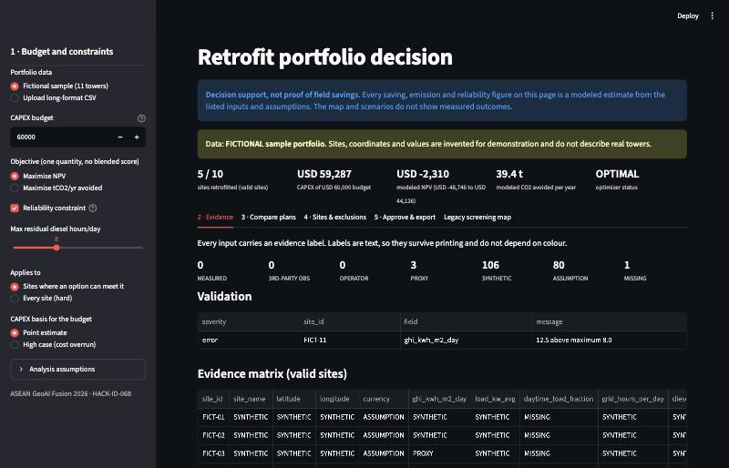
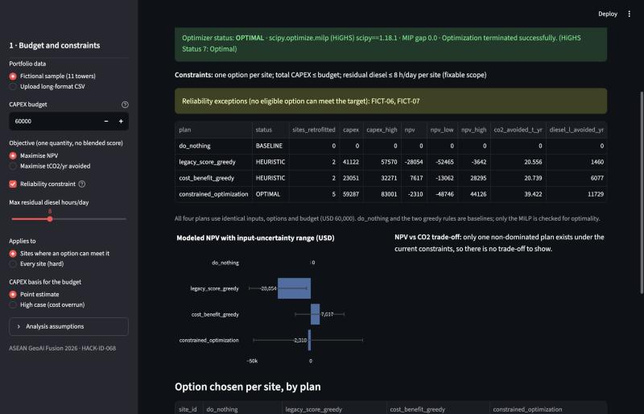
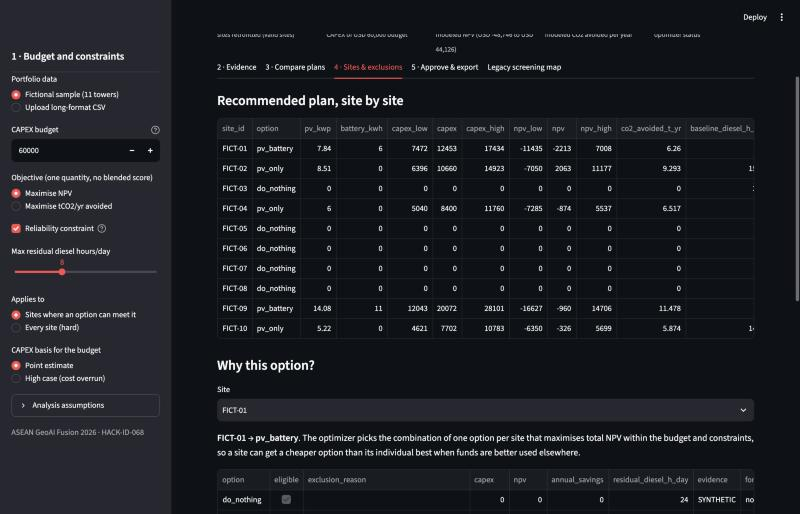

# ☀️ SUNTOWER-AI

> **Retrofit portfolio decision support for telecom tower energy**

*Not where the sun shines — where your investment shines brightest.*

SUNTOWER-AI helps a TowerCo energy planner choose which towers get which energy retrofit (`pv_only`, `battery_only`, `pv_battery` or `do_nothing`) under a finite CAPEX budget and an optional reliability constraint. Every input shows whether it is measured, a proxy, an assumption or synthetic.

> **Decision support, not proof of field savings.** All savings, emissions and reliability numbers are modeled estimates from the inputs and assumptions shown. No result in this repository is field-verified. The bundled demo portfolio is **fictional**.

## Status

| Module | Status |
|---|---|
| Typed `site_features` schema, evidence labels, validation | IMPLEMENTED · TESTED |
| Retrofit option estimates with ranges and formulas | IMPLEMENTED · TESTED |
| Constrained optimisation (MILP, SciPy/HiGHS) + 3 baselines | IMPLEMENTED · TESTED |
| Decision memo (printable HTML/Markdown) + reproducibility CSV | IMPLEMENTED · TESTED |
| Decision-centred Streamlit app (legacy map kept as a tab) | IMPLEMENTED · smoke-TESTED |
| Predictive model (daily site energy) | PLANNED: interface and synthetic unit test only; no real labels |
| Earth Engine feature extraction (`scripts/gee_feature_extraction.js`) | PLANNED: demo script, not connected to the pipeline |
| Field validation with operator data | BLOCKED: needs operator data and a data-sharing agreement |

## Quick start

```bash
python3 -m venv .venv && source .venv/bin/activate
pip install -r requirements.txt
streamlit run app/streamlit_app.py          # app; opens with the fictional portfolio
python scripts/seno_workflow.py --budget 60000 --max-diesel-hours 8 --out outputs/example
python -m pytest -q                          # 64 tests
```

Tested on macOS arm64 with Python 3.12.13 (package versions are in `docs/SENO_EXECUTION_EVIDENCE.md`).

## User path in the app

1. **Set budget and constraints** (sidebar): CAPEX budget, one objective (NPV *or* tCO2/yr), max residual diesel hours per site, point or high-case CAPEX.
2. **Evidence**: validation issues, and a site × field matrix of text labels (`MEASURED`, `PROXY`, `SYNTHETIC`, `ASSUMPTION`, `MISSING` …) that does not rely on colour.
3. **Compare plans**: `do_nothing`, legacy score + greedy, cost/benefit greedy and the MILP, all run on identical inputs. Shows optimizer status, MIP gap, active and violated constraints, NPV ranges, and the NPV–CO2 Pareto sweep.
4. **Sites & exclusions**: per-site option, CAPEX/NPV ranges, before/after diesel hours, all options with formulas, ineligible options with reasons, sites rejected by validation.
5. **Approve & export**: memo preview, review checkbox, printable HTML/Markdown memo, chosen-plan CSV, all-options CSV.





*Screenshots taken from the running app on the fictional sample, budget USD 60,000, max 8 diesel h/day.*

## Method

- **Input**: a long-format CSV with one row per `(site_id, field)`: `value, unit, source, as_of_date, evidence_type, uncertainty_pct, notes`. Field definitions, units and plausibility ranges are in `scripts/site_schema.py` (`FIELD_SPECS`).
- **Validation**: rejects bad coordinates, wrong units, mixed currencies, negative costs, implausible tariffs and emission factors, duplicate rows and duplicate towers (within 25 m). It also rejects `measured`/`operator_supplied` values without a source and date. Invalid sites are excluded and listed, never silently fixed.
- **Options** (`scripts/retrofit_options.py`): PV sized from GHI × performance ratio, battery from autonomy hours, displaced diesel/grid energy, CAPEX, O&M, NPV over the horizon and CO2. Ranges come from the per-field uncertainty. Each option carries the weakest evidence label among its inputs.
- **Optimisation** (`scripts/portfolio_optimizer.py`): at most one option per site, total CAPEX ≤ budget, eligibility, and an optional cap on residual diesel hours. The objective is a single quantity; dollars and tonnes are never added. Trade-offs are shown with an epsilon-constraint sweep. If SciPy is missing, a greedy fallback runs and reports `HEURISTIC_FALLBACK`.
- **Service population** is a proxy and is never summed across towers, because overlapping coverage is not de-duplicated.

## Data sources and rights

See `docs/DATA_RIGHTS.md` and `data/provenance.csv`. In short:

- `data/sample_portfolio_fictional.csv`: fictional (project-generated).
- `data/towers_enriched.csv` (legacy): Bandung tower inventory 2017–2020 from the AGAIF bootcamp materials (**licence unverified**). Every derived column is a **formula proxy** from `scripts/data_pipeline.py`, not satellite or site data.
- Global Solar Atlas, WorldPop, SRTM, VIIRS, WorldCover, OSM and OpenCelliD are **not used** by the current code. Their reported licences are listed for future use.

## Known limitations

- No real site data has been run through the workflow; all demo inputs are fictional or modeled.
- The energy model uses daily averages: flat load profile, outages assumed uniform over the day, no battery degradation or replacement, no tariff time-of-use.
- The reliability measure is estimated residual generator hours/day, not measured availability.
- The legacy dataset repeats towers across four years and classifies 3,531 of 3,532 rows as "Strong Grid". See `docs/SENO_BASELINE_AUDIT.md`.
- No predictive AI is demonstrated.

## Documentation

- `docs/SENO_BASELINE_AUDIT.md`: reproduction record and claim-to-evidence ledger
- `docs/SENO_EXECUTION_EVIDENCE.md`: commands, test output, before/after comparison
- `docs/SENO_TKT_SELF_ASSESSMENT.md`: informal TKT self-assessment (not an official designation)
- `docs/DATA_RIGHTS.md`: data rights and licences

## Project structure

```
app/streamlit_app.py            Decision UI (+ legacy screening map tab)
scripts/site_schema.py          Schema, evidence labels, validation
scripts/retrofit_options.py     Option estimates and assumptions
scripts/portfolio_optimizer.py  MILP + baselines + plan checks + Pareto sweep
scripts/decision_memo.py        Memo (MD/HTML) and export CSV
scripts/seno_workflow.py        End-to-end workflow / CLI
scripts/energy_forecast.py      Phase 3 interface (PLANNED)
scripts/make_fictional_sample.py  Generates the fictional sample
scripts/data_pipeline.py, scoring_engine.py, gee_feature_extraction.js   Legacy v2
data/                           Sample portfolio, legacy data, provenance.csv
tests/                          pytest suite
```

## 🌏 ASEAN GeoAI Fusion 2026

**Team**: HACK-ID-068
**Theme**: ESG (Environmental, Social, and Governance)
**Hackathon**: ASEAN GeoAI Fusion 2026 by MCMC. Extended for the SENO Hackathon ITS 2026.

*Built for the ASEAN GeoAI Fusion 2026 Hackathon.* The portfolio extension (schema, optimizer, memo, tests, docs) was written with AI coding assistance (Claude Code); the team must review it before any submission.
